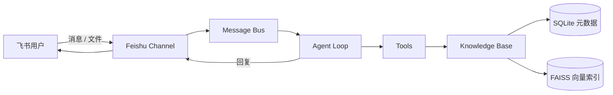

# 小文（Xiaowen）

具备工具调用、任务执行与个人知识库能力的智能 Agent，并通过飞书作为主要交互入口。

小文帮助你在飞书中完成日常对话、文档处理和知识检索：理解用户意图，调用工具执行任务，并基于上传文档进行内容总结与问答。

---

## 核心功能

### Agent 对话与任务执行

- 理解自然语言请求，结合上下文完成多轮对话
- 调用工具完成读文件、检索、执行等操作
- 在飞书中返回结果，支持进度反馈与流式输出（取决于飞书应用权限）

### 工具调用机制

- 内置工具自动发现与注册
- 支持知识库上传、检索与文件访问相关能力
- 可按配置扩展 Provider / MCP 等外部能力（视本地配置而定）

### 飞书消息交互

- 通过 WebSocket 长连接接入飞书 / Lark，无需公网 Webhook
- 支持私聊与群聊（群聊可配置为 mention 策略）
- 首次交互发送欢迎说明；私聊文件到达后可进行意图确认
- 支持配对（pairing）或白名单控制用户访问

### 飞书文件接收与处理

- 自动接收飞书文件消息并下载到本地运行目录
- 校验文件格式与大小
- 支持 SHA256 去重，避免重复入库
- 超限或不支持格式会给出明确提示，不进入后续索引流程

### 个人知识库

- 文档入库、解析、切分、Embedding 与向量索引
- 基于向量检索关联原始文件来源
- 会话级 pending 文件管理，降低并发上传时的状态混乱
- 文件访问边界约束，降低跨会话误读个人文件的风险

### 已实现能力范围（以源码为准）

| 能力 | 状态 |
|------|------|
| 飞书对话 / 文件接收 | 已实现 |
| 格式校验、50 MiB 大小限制 | 已实现 |
| PDF / DOCX / TXT / Markdown / XLSX 解析 | 已实现 |
| 文本分块、Embedding、FAISS 索引 | 已实现（需额外安装向量依赖） |
| 知识库检索与上传工具 | 已实现 |
| PPTX / 旧版 DOC / 图片 OCR | **未实现** |
| 扫描版 PDF OCR | **未实现** |

---

## 系统架构



说明：

1. 飞书 Channel 负责消息与文件接入  
2. Agent 负责理解请求并调用工具  
3. 知识库负责文件保存、解析、索引与检索  
4. Gateway 作为常驻进程，驱动 Channel 与 Agent 运行

---

## 技术栈

根据 `pyproject.toml` 与源码实际使用情况：

| 类别 | 技术 |
|------|------|
| 语言 | Python ≥ 3.11 |
| CLI | Typer、Rich |
| 配置与数据模型 | Pydantic |
| 飞书接入 | lark-oapi（可选插件依赖） |
| 文档解析 | pypdf、python-docx、openpyxl |
| 元数据存储 | SQLite |
| Embedding | sentence-transformers（运行时依赖，需单独安装） |
| 向量索引 | FAISS（运行时依赖，需单独安装） |
| 网络与异步 | httpx、aiohttp、websockets |

> 说明：`sentence-transformers` 与 `faiss-cpu` **不在** 主依赖列表中。知识库向量能力在首次使用前需要自行安装。

---

## 项目运行

### 环境要求

- Python **3.11 或 3.12**（项目 classifiers 声明支持范围；更高版本兼容性待自行验证）
- 可访问的 LLM Provider（OpenAI 兼容接口 / Anthropic 等，按本地配置）
- 飞书或 Lark 机器人应用（App ID / App Secret）
- 如使用知识库向量能力：可安装 `sentence-transformers` 与 `faiss-cpu`

### 从源码安装

在项目根目录执行：

```bash
python -m venv .venv
```

Windows PowerShell：

```powershell
.venv\Scripts\Activate.ps1
python -m pip install -e .
```

macOS / Linux：

```bash
source .venv/bin/activate
python -m pip install -e .
```

安装后入口命令为：

```bash
nanobot --help
```

等价方式：

```bash
python -m nanobot --help
```

### 初始化配置与工作区

```bash
nanobot onboard
```

交互式引导（可选）：

```bash
nanobot onboard --wizard
```

默认实例目录：

| 路径 | 用途 |
|------|------|
| `~/.nanobot/config.json` | 主配置（Provider、Channel、模型等） |
| `~/.nanobot/workspace/` | 工作区、记忆与技能等 |
| `~/.nanobot/` 下运行时子目录 | 会话、媒体、知识库文件与索引等 |

可通过全局参数覆盖实例根目录：

```bash
nanobot --home <实例目录> ...
```

### 配置 LLM

在 WebUI 中配置，或直接编辑 `~/.nanobot/config.json` 中的 `providers` / `modelPresets` / `agents.defaults`。

检查本地配置是否就绪：

```bash
nanobot status
```

终端快速验证（不经过飞书）：

```bash
nanobot agent -m "Hello!"
```

### 启用飞书并登录

```bash
nanobot plugins enable feishu
nanobot channels login feishu
```

`channels login feishu` 支持扫码创建/绑定机器人，并将 `appId`、`appSecret`、`domain`、`enabled` 写入当前配置。

也可在配置文件中手动写入（示例）：

```json
{
  "channels": {
    "feishu": {
      "enabled": true,
      "appId": "cli_xxx",
      "appSecret": "xxx",
      "groupPolicy": "mention",
      "streaming": true,
      "domain": "feishu"
    }
  }
}
```

飞书开放平台侧通常需要：

- 启用机器人能力
- 订阅接收消息事件
- 使用 **长连接（WebSocket）** 模式
- 如需流式卡片，确认具备相关 CardKit 权限；否则可将 `streaming` 设为 `false`

### 启动 Gateway

前台启动：

```bash
nanobot gateway
```

后台启动：

```bash
nanobot gateway --background
nanobot gateway status
```

常用管理命令：

```bash
nanobot gateway logs
nanobot gateway restart
nanobot gateway stop
```

也可使用 WebUI 启动器（会拉起本地服务）：

```bash
nanobot webui
```

### 必要配置说明

| 项 | 说明 |
|----|------|
| LLM Provider API Key / Base | 必须配置，否则 Agent 无法正常回答 |
| 飞书 `appId` / `appSecret` | 飞书通道必需 |
| `allowFrom` / pairing | 控制谁可以使用机器人 |
| 向量依赖 | 知识库索引前需安装 FAISS 与 sentence-transformers |

环境变量可在配置中以 `${VAR}` 形式引用（以配置加载器实际支持为准）。**请勿把真实密钥写入仓库。**

### 待确认项

以下内容以你的本机环境为准，README 不做猜测：

1. 你实际使用的 LLM Provider 名称与模型 ID  
2. 是否启用 WebUI 打包资源（前端构建产物是否已生成）  
3. `faiss-cpu` 在当前 Python / 操作系统上的可安装版本  
4. 生产部署时的进程守护方式（systemd / Windows 服务 / 容器等）

---

## 知识库使用说明

### 支持的文件格式

- PDF
- DOCX
- TXT
- Markdown（`.md`）
- XLSX

**暂不支持（知识库内容识别）：** PPTX、旧版 DOC、图片 OCR。

### 上传方式

1. 在飞书私聊中向小文发送支持格式的文件  
2. 系统下载文件后自动校验格式与大小  
3. 通过后写入知识库元数据，并尝试完成解析与索引  
4. 私聊场景下，成功保存后可能先发送文件确认消息，再等待你的具体任务指令

### 处理过程

```text
接收文件 → 格式/大小校验 → SHA256 去重 → 落盘保存
       → 解析文本 → 分块 → Embedding → FAISS 索引
       → 可检索 / 可回答
```

限制：

- 单文件默认上限 **50 MiB**
- 飞书侧通常无法在下载前获知文件大小，因此大小检查发生在下载之后
- 重复内容（相同哈希）会识别为已存在文件

### 使用边界

- 知识库面向个人/授权用户文档，不应当作公开共享库
- 私聊 pending 文件与会话绑定，用于当前文件意图处理
- Agent 侧对飞书媒体文件读取有归属校验，降低跨用户误读风险
- 群聊场景下的 pending 文件策略与私聊不完全相同（私聊能力更完整）

---

## 项目目录

```text
项目根目录/
├── nanobot/                 # 核心代码包
│   ├── agent/               # Agent 循环、工具
│   ├── channels/            # 各通道实现（含 feishu）
│   ├── kb/                  # 知识库：解析、切分、索引
│   ├── session/             # 会话与 SQLite
│   ├── cli/                 # 命令行入口
│   ├── gateway/             # Gateway 运行时
│   ├── config/              # 配置与路径
│   └── templates/           # 提示词与身份模板
├── tests/                   # 自动化测试
├── docs/                    # 文档与开发记录
├── webui/                   # WebUI 前端源码
├── tui/                     # 终端 UI
├── scripts/                 # 安装与辅助脚本
├── pyproject.toml           # 依赖与入口定义
├── LICENSE                  # MIT 许可证
└── THIRD_PARTY_NOTICES.md   # 第三方声明
```

Python 包名与 CLI 入口仍为 `nanobot`（见 `pyproject.toml` 的 `project.scripts`）。

---

## 许可证与致谢

本项目以 **MIT License** 发布，详见根目录 [`LICENSE`](./LICENSE)。

第三方组件声明见 [`THIRD_PARTY_NOTICES.md`](./THIRD_PARTY_NOTICES.md)。再分发时请保留许可证与必要版权声明。

主要开源依赖（部分）：

- Typer / Pydantic / httpx / aiohttp  
- pypdf / python-docx / openpyxl  
- sentence-transformers / FAISS（知识库向量能力）  
- 飞书开放平台 Python SDK（lark-oapi，通道插件）

---

## 开发与测试（可选）

安装开发依赖：

```bash
python -m pip install -e ".[dev]"
```

运行与飞书 / 知识库相关的测试示例：

```bash
python -m pytest nanobot/channels/feishu/tests -q
python -m pytest tests/kb -q
```

---

**小文**：在飞书中对话、处理文档，并基于个人知识库回答问题。
